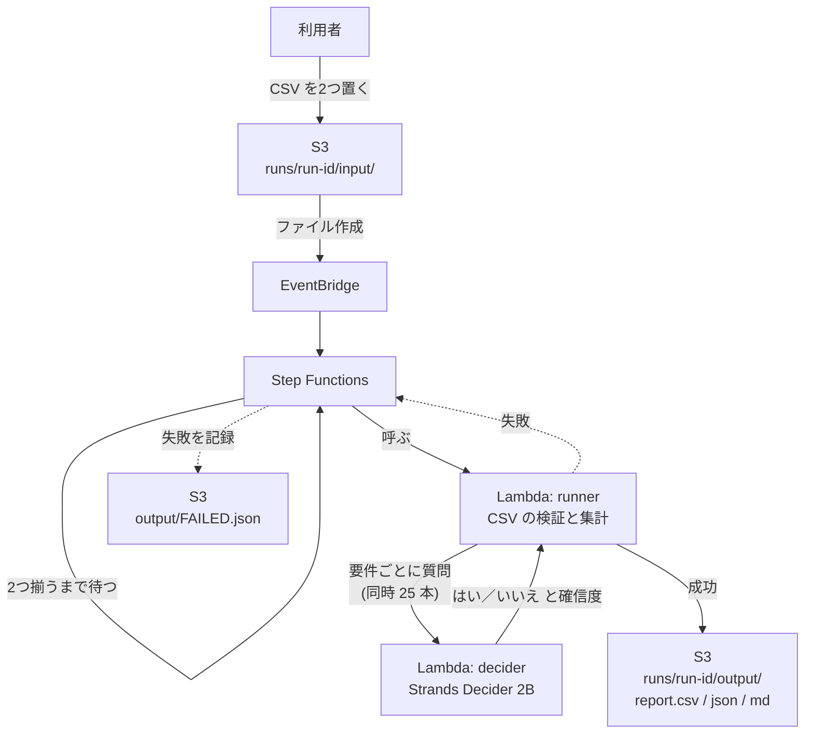

# req-coverage-analyzer

要件定義とE2Eテスト一覧（CSV）を突き合わせ、AIを用いて「どの要件がどのE2Eテストでカバーされているか」を自動判定し、レポートにするシステム。

検証用途（PoC）のMVPとして、実用性とコスト効率を最速で確かめる。

## 開発の進め方

[GitHub Spec Kit](https://github.com/github/spec-kit) による仕様駆動開発。
実装の前に、仕様（`specs/`）と憲章（`.specify/memory/constitution.md`）を定め、それを正として進める。

## 技術スタック

| 分類 | 内容 |
| --- | --- |
| AIモデル | Strands Decider 2B（AWS Strands Labs。分類と判断に特化した小さなモデル） |
| 実行環境 | AWS Lambda（公式の Lambda 版、CPU の arm64） |
| オーケストレーション | AWS Step Functions、Amazon EventBridge |
| ストレージ | Amazon S3 |
| IaC | AWS CDK（TypeScript） |
| パッケージ管理 | pnpm 12（Node.js と Python を一括）、ツールの版は mise で固定 |

## 処理の流れ

常時動く計算資源はなく、使った時間だけ課金される。



| 段階 | 内容 |
| --- | --- |
| 入力 | 要件とE2Eテストの CSV を、実行フォルダに置く |
| 起動 | EventBridge が検知し、Step Functions が始まる。2つ揃うまで最大10分待つ |
| 判定 | runner が、要件1件ごとに、全テストについて「確かめているか」を decider に尋ねる |
| 出力 | 成功なら `report.*`、失敗なら `FAILED.json` を置く |

## 構成

| 場所 | 内容 |
| --- | --- |
| `bin/`, `lib/` | AWS CDK（TypeScript） |
| `src/` | 判定用の Lambda（Python） |
| `tests/` | 単体テスト（業務ロジック）と E2E |
| `specs/` | 仕様、設計、サンプル |
| `.specify/` | Spec Kit（憲章、テンプレート） |

## パッケージ管理

pnpm 12（Python 対応は Experimental）で Node.js と Python の依存を一括管理する。
ロックファイルは `pnpm-lock.yaml`（Node.js）と `pylock.toml`（Python）。

## セットアップ

```sh
mise install
pnpm install
```

## デプロイと使い方

東京リージョン（ap-northeast-1）を前提とする。AWS の認証と、CDK のブートストラップが済んでいること。

1. 公式の decider を、先にデプロイする（約8分）。手順と固定したコミットは、[quickstart](specs/001-requirement-coverage-analysis/quickstart.md) を参照する。
   出力の `FunctionArn`（別名 `live`）を控える。
2. このスタックをデプロイする（約2分）。

   ```sh
   pnpm cdk deploy -c deciderFunctionArn=<控えた ARN>
   ```

3. 出力の `BucketName` のバケットに、`runs/<run-id>/input/requirements.csv` と `runs/<run-id>/input/e2e-tests.csv` を置く。
4. `runs/<run-id>/output/` に、`report.md`、`report.csv`、`report.json`（失敗なら `FAILED.json`）が出る。
   再実行は、新しい `<run-id>` で行う。形式は [契約](specs/001-requirement-coverage-analysis/contracts/) を参照する。
5. 使い終わったら、`pnpm cdk destroy -c deciderFunctionArn=<ARN>` と、decider 側の `npx cdk destroy` で消す。

### 実測（東京、2026-11-14）

| 項目 | 結果 |
| --- | --- |
| サンプル（要件12件 × テスト15件） | 約 1 分（decider が温まっているとき） |
| 要件100件 × テスト100件（冷えた decider） | 約 4 分 43 秒（30分の目標に収まる） |
| 1回の実行の費用 | 約 $1〜4（冷えた環境が多いほど高い） |
| 待機中の費用 | 月 約 $0.25（decider のイメージ） |
| 判定の精度（サンプル） | 誤検出 0 件、見つけた割合 64%（詳細は [research](specs/001-requirement-coverage-analysis/research.md)） |

「カバーされている」は信頼できる。「カバーされていない」は、見逃しの可能性があるため、人が確かめる。

### 入力の決まり

- CSV は UTF-8 で、ヘッダは `id,description`。100行まで、128 KB まで。
- `id` は、64字まで。文字、数字、`_`、`.`、`-` だけ。`description` は、120字まで。
- 入力は、信頼できる人が用意したものとする。説明の文に、モデルへの指示を書くと、その行の判定を動かせる。
- 入力とレポートは、30日で消える。

## タスク

```sh
pnpm build      # CDK の型の検査
pnpm cdk synth -c deciderFunctionArn=<decider の別名 live の ARN>  # テンプレートの生成
pnpm lint       # ruff、tsc、markdownlint-cli2
pnpm test       # 単体テスト（業務ロジック）
pnpm test:e2e   # E2E（デプロイ済みのスタックが必要。環境変数 E2E_BUCKET にバケット名を渡す）
```

デプロイの手順は、[quickstart](specs/001-requirement-coverage-analysis/quickstart.md) を参照する。
