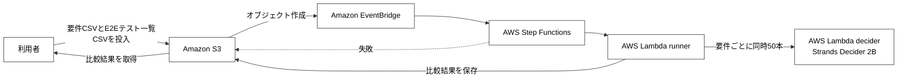

<!-- markdownlint-disable MD025 -->

# Kiro CrewでStrands Decider 2Bに関する技術検証をやってみた

- Kiro Crew と GitHub Spec Kit(仕様駆動開発)で、要件とE2Eテストの対応を自動判定するMVPを作った
- 意思決定モデル Strands Decider 2B を、AWS Lambda(CPU)で動かした

---

# 目次

1. Kiro Crew の基本機能と気になるところ
2. 技術検証の内容
3. 意思決定モデルと、Strands Decider 2B
4. Strands Decider 2B による要件とE2Eの充足度の判定
5. Kiro Crew の指示の流れ
6. 投入したプロダクト概要
7. 検証結果
8. 使用してみて気になる点
9. まとめ

---

# 1. Kiro Crewの基本機能と気になるところ

任せて離れて、戻ったら成果がある

---

# 1. Kiro Crewとは

| 項目 | 内容 |
| --- | --- |
| 始まり | Amazon社内の個人プロジェクト(MeshClaw) |
| 土台 | Kiro CLI |
| 公開 | オープンソース |
| 操作 | アプリ、Web、TUI、Slack |
| 実行場所 | ローカル、リモートマシン |

出典: [Kiro Crew の紹介(AWSブログ)](https://aws.amazon.com/jp/blogs/news/introducing-kiro-crew/)

<!-- 話す内容: タスクを投げて離れ、戻ったらレビューできる成果がある、という動機から始まった。Slack、Telegram、Discordからも同じ作業を続けられる -->

---

# 1. Kiro Crewのターゲット

| 項目 | 内容 |
| --- | --- |
| 想定 | 開発者 |
| 広がり | 社内39,000人超。貢献者は多様な職種 |
| Kiro利用者 | `.kiro`の設定をそのまま使える |
| 向く作業 | 複数セッションにまたがる作業 |

出典: [Kiro Crew の紹介(AWSブログ)](https://aws.amazon.com/jp/blogs/news/introducing-kiro-crew/)

<!-- 話す内容: ブログに「開発者のために一から作られた」とある。向く作業の例は、マイグレーション、定期レビュー、PRの監視 -->

---

# 1. Kiro Crewの機能

| 機能 | 内容 |
| --- | --- |
| チャット | 複数の会話、サブエージェントを並列に |
| ワークフロー | 目的から組み立て、途中から再実行 |
| スケジュール | 定期ジョブ、見張り、Webhook |
| メモリ、スキル | 訂正を教訓にして引き継ぐ |
| 連携 | MCP、ブラウザ操作 |
| Apps | 目的特化の画面を追加 |
| セキュリティ | サンドボックス、署名付き監査ログ |

出典: [Kiro Crew の紹介(AWSブログ)](https://aws.amazon.com/jp/blogs/news/introducing-kiro-crew/)

<!-- 話す内容: 席を離れても止まらないことが共通のテーマ。推論が要らない定期ジョブはモデルを呼ばない。メモリ、教訓、スキルは常に閲覧、編集、削除できる -->

---

# 1. 特有の機能① エージェントハーネスの選択

> 新規セッションごとに基盤を選ぶ(Settings -> Agent Harness)

| 基盤 | 備考 |
| --- | --- |
| Kiro CLI | 既定 |
| Claude Code | |
| Codex | サンドボックス必須 |
| OpenCode、goose | |
| Kiro Agent | 内蔵エンジン |
| Pi | CrewのMCPツールは不可 |

- Kiro CLI以外はExperimental
- 動作中のセッションは切り替えられない

出典: [Agent backends](https://kiro.dev/docs/crew/features/agent-backends/)

<!-- 話す内容: Claude Code側で事前承認したツールは、Crewの承認フローを通らず、拒否や監査の対象外になる。監査境界を決めてから選ぶ -->

---

# 1. 特有の機能② 意思決定モデルの選択(プレビュー版)

> 小さなモデルに「判断だけ」をさせる(Jev)

| 判断 | 内容 |
| --- | --- |
| モデル選択 | simple / medium / complex |
| スキル選択 | 読み込むスキルを選ぶ |
| 割り込み | 方向修正か、次のターンか |
| 記憶の絞り込み | 入れる記憶を選ぶ |
| 見張りの起床 | 変化がなければ飛ばす |

- 既定は無効
- 外部サービスのAPIキーが要る
- 失敗時は従来の動作

出典: Kiro Crew 同梱のドキュメント

<!-- 話す内容: Settings -> Developer -> Feature Previews のDecisionsスイッチ。設定例の判断先は外部のホスト型サービスで、会話の一部が外へ出る -->

---

# 1. Kiro Crewの気になるところ

| 気になる点 | 内容 |
| --- | --- |
| Claude Desktopとほぼ同じ | チャット、定期実行、メモリは双方にある |
| メモリを消費する | 複数案件の同時実行は厳しい |
| 設定がKiro CLIと別 | MCP、パーミッションが別管理 |

<!--
話す内容
- 違いは基盤を選べること、手元で動くこと、オープンソースであること
- メモリは、PC(スペックを記入)で複数案件を回して重くなった体験談
- パーミッションは、Kiro CLIのpermissions.yamlがKiro Crewに効かない。
  Kiro CrewはSettings -> Securityの拒否リストで制御する
- MCPはCustomize -> Connectionsで管理する。
  追加後はゲートウェイの再起動と新しいチャットが要る場合がある
-->

---

# 1. メインPCではなく、サブPCやEC2に入れる

> 人のマシンと、AIのマシンを分ける

```text
手元のPC(人)──SSMトンネル──> EC2(Kiro Crew、AI専用)
```

| 理由 | 内容 |
| --- | --- |
| メモリ | 他の作業を圧迫しない |
| 権限 | AI用の権限を分離する |
| 案件 | 案件ごとにマシンを分ける |
| 接続 | ポートを開けずにつなぐ |

出典: Kiro Crew 同梱のドキュメント(Remote Crew)

<!-- 話す内容: Remote Crewの機能で、手元のダッシュボードからSSMまたはSSHのトンネル経由で開く。各マシンのダッシュボードはループバックのみ。サブPCでも考え方は同じ -->

---

# 2. 技術検証の内容

## このリポジトリの目的

- 要件定義とE2Eテスト一覧(CSV)を突き合わせる
- 「どの要件が、どのE2Eテストで確かめられるか」をAIで判定する
- 判定結果(比較結果)をレポートで返す

## 検証したいこと

- 実用になる精度か
- 費用と所要時間は現実的か
- 仕様駆動開発で、AIエージェントがどこまで作れるか

---

# 3. 意思決定モデルとは

- 文章を作らない
- 選択肢から1つを選び、確信度(0〜1)を返す
- 分類と判断に特化し、小さくて速い

```text
質問: この要件は、このテストで確かめられるか?
答え: はい(確信度 0.93)
```

---

# 3. Strands Decider 2B

| 項目 | 内容 |
| --- | --- |
| 提供元 | AWS Strands Labs |
| 大きさ | 19億パラメータ(1.9 billion。名前の「2B」は、ベースモデルの大きさ) |
| ベースモデル | Qwen3.5-2B-Base(ライセンスは Apache-2.0) |
| 仕組み | 選択肢を1回の計算で採点する(文章を生成しない) |
| 出力 | 選択肢ごとのスコア(0〜1) |
| 1回の入力上限 | 24,576トークン(Lambda 版の既定値 `max_request_tokens`。変更可) |
| 公式の動かし方 | AWS Lambda(GPUなし。CPUだけで動く)、Amazon SageMaker、手元のGPU/Mac/CPU |
| 公式の目安 | 確信度0.9以上は、おおよそ95%正しい |

- 「理由の文章」は出せない。根拠は確信度で残す

参考(公式)

- [strands-decider(GitHub・概要)](https://github.com/strands-labs/strands-decider)
- [モデル(Hugging Face)](https://huggingface.co/StrandsAgents/strands-decider-2B-qwen3.5-v1-2610)

---

# 3. Strands Decider 2B の動かし方

| 方法 | 計算に使うもの | 特徴 |
| --- | --- | --- |
| 自分のサーバーで起動 | GPU付きの Amazon EC2 など | 1回約0.1秒。止め忘れると課金が続く |
| Amazon SageMaker | 公式が用意した方法の1つ | 今回は使っていない |
| **AWS Lambda(今回)** | **CPUだけ**(arm64、メモリ10,240 MB) | 1回数秒〜数十秒。使った秒数だけ課金。待機中は月約$0.25 |

- 2B(19億)は小さいため、GPUなしの CPU でも動く
- Lambda 版は、モデルを入れたコンテナイメージを Amazon ECR に置き、AWS Lambda が実行する
- 公式の AWS CDK のスタックが、イメージ作成から関数の作成までを行う

---

# 3. Strands Decider 2B の使い方(Lambda 版)

1. 公式の `deploy/lambda` を、固定したコミットでデプロイ(約8分)
1. 関数の別名 `live` を、AWS SDK で呼び出す
1. 質問を JSON で送る

```json
{"state": "要件の文",
 "questions": {"q1": {"type": "noul", "instructions": "このテストで確かめられるか: テストの文"}}}
```

1. 答えが返る: `{"answers": {"q1": {"type": "noul", "noul": 0.93}}}`
   - 0〜1 で、1に近いほど「はい」

参考(公式)

- [推論の手順(docs/inference.md)](https://github.com/strands-labs/strands-decider/blob/main/docs/inference.md)
- [Lambda 版のデプロイ(deploy/lambda)](https://github.com/strands-labs/strands-decider/tree/main/deploy/lambda)

---

# 4. 充足度の判定: 構成



---

# 4. 充足度の判定: 判定のしかた

- 要件1件を「状態」にする
- 全E2Eテストを「はい/いいえ」の質問にする
- 1要件につき1回の呼び出しで、全テストを判定する
- スコア0.5以上を「はい」とする
- 1件でも「はい」があれば、その要件は「対応あり」

---

# 4. 充足度の判定: 設計の要点

| 点 | 内容 |
| --- | --- |
| 待機中の費用 | 月 約$0.25(常時動く資源なし) |
| 重複起動 | Amazon S3 の条件付き書き込みで1回だけ動かす |
| 失敗時 | `FAILED.json` を置く。1組でも失敗したら全体を失敗にする |
| 全体の上限 | 30分 |

- 当初はGPUのEC2案。公式のLambda版(CPU)と比べ、Lambda案へ変更した

---

# 5. Kiro Crew の指示の流れ

- AWS MCP設定: 東京リージョンの aws-mcp を追加
- Spec Kit インストール: `specify` を導入(kiro-cli連携)
- プロダクト概要の投入: 概要を渡し、Spec Kit を回し始める
  - constitution(憲章): プロジェクトの原則を決める
  - specify(仕様): 作るものを書く
  - clarify(曖昧点の確認): 質問に答えて仕様を固める
  - plan(設計): 構成と方式を決める
  - tasks(作業分解): 34個の作業に分ける
  - analyze(食い違い点検): 書類どうしのずれを直す
  - implement(実装とデプロイ): 作業の順に実装し、AWSで確かめる

---

# 5. 各段階でやったこと

| 段階 | 内容 |
| --- | --- |
| AWS MCP設定 | 東京リージョンの aws-mcp を追加 |
| Spec Kit | `specify` 1.4.0 を導入(kiro-cli連携) |
| 概要投入 | プロダクト概要を渡し、初手の基盤を決めた |
| constitution〜tasks | 原則、仕様、設計、34個の作業を作成 |
| analyze | 9点の食い違いを直した |
| implement | tasks順に、赤→緑で実装。AWSへデプロイしE2Eで確認 |

- 人は、各段階で選択肢を選び、事実や方針を答えた

---

# 6. 投入したプロダクト概要(要約)

- **目的**: 要件とE2Eテスト一覧を突き合わせ、カバー状況を自動判定する(PoC向けMVP)
- **進め方**: GitHub Spec Kit による仕様駆動開発
- **AIモデル**: Strands Decider 2B
- **構成(当初)**: Amazon EC2(GPU)、AWS Step Functions、AWS Systems Manager、Amazon S3、AWS CDK
- **流れ**: S3にCSV投入 → 自動起動 → 推論 → レポート → 停止

→ 検証の途中で、EC2/GPU案から AWS Lambda 案へ変更

---

# 7. 検証結果: 動作(処理時間とコスト)

| 検証項目 | コールド／ウォーム | 所要時間 | コスト |
| --- | --- | --- | --- |
| 100要件×100テスト(10,000組) | コールド | 4分35秒 | 約$1.38 |
| 100要件×100テスト(10,000組) | ウォーム | 4分17秒 | 約$1.30 |

- 所要時間は、CSV を置いてからレポートが出るまで(AWS Step Functions の実行記録)
- コストは、decider の課金時間(コールド10,367秒、ウォーム9,795秒)に、公式の単価(1秒あたり$0.000133)を掛けた概算
- コストに、runner、Amazon S3 などは含まない(小さいため)
- コールドは新規起動50本、ウォームは0本(decider のログで確認)
- 差は小さい。decider は同時50本で、100要件を2回に分けて処理する
- 以前の測定(関数1つを単独で呼ぶ)では、コールドスタートに約5分かかった。今回は差が小さく、理由は確かめていない

---

# 7. 検証結果: 待機費用とテスト

| 項目 | 結果 |
| --- | --- |
| 待機中の費用 | 月 約$0.25 |
| 単体テスト | 80件 通過 |
| E2E | 9件 通過 |

---

# 7. 検証結果: 精度(サンプル)

| 指標 | 値 |
| --- | --- |
| 誤検出(出した「はい」のうち不正解) | 0件 |
| 見つけた正解 | 9組 / 14組 |
| 要件ごとの一致 | 11件 / 12件 |

- 「対応あり」は信頼できる
- 「対応なし」には見逃しがある

---

# 7. 検証結果: 要件ごとの比較

| 要件 | 実際のテスト | モデルの判定 | 確度 | 実際のテスト数 | モデルが見つけた数 |
| --- | --- | --- | --- | --- | --- |
| REQ-001 メールとパスワードでログイン | あり | あり | 0.88 | 2 | 1 |
| REQ-002 5回失敗で15分ロック | あり | あり | 0.90 | 1 | 1 |
| REQ-003 出勤ボタンで出勤を打刻 | あり | あり | 0.93 | 2 | 1 |
| REQ-004 退勤ボタンで退勤を打刻 | あり | あり | 0.92 | 1 | 1 |
| REQ-005 打刻漏れの日に修正を申請 | あり | あり | 0.89 | 1 | 1 |
| REQ-006 管理者が修正申請を承認・却下 | あり | なし | | 2 | 0 |
| REQ-007 有給休暇を申請、残日数を更新 | あり | あり | 0.79 | 2 | 1 |
| REQ-008 月ごとの勤務時間と残業の集計 | なし | なし | | 0 | 0 |
| REQ-009 部署ごとの勤怠を一覧 | あり | あり | 0.91 | 1 | 1 |
| REQ-010 月次の勤怠をCSVでダウンロード | あり | あり | 0.79 | 1 | 1 |
| REQ-011 自分の勤怠履歴を月ごとに確認 | あり | あり | 0.89 | 1 | 1 |
| REQ-012 36協定の上限超えを警告 | なし | なし | | 0 | 0 |

---

# 7. 検証結果: 読み解き

- 不一致は REQ-006 の1件だけ(本当はテストがあるのに「なし」)
- 見逃した5組は、失敗・拒否・承認の分岐を確かめるテスト
  - 例: パスワード誤り、二重打刻の拒否、承認/却下
- 見逃しの確信度は 0.08〜0.30、見つけた組は 0.79〜0.93 と二極に分かれる
- しきい値を動かしても、見逃しを拾う前に誤検出が増える
- 質問の文言を4通り試したが、結果は変わらない

---

# 7. 検証結果: レポートの見方

重点的に見る場所は3つ。

| 見るもの | 理由 |
| --- | --- |
| 「対応なし」の要件 | 見逃しがありうる(REQ-006) |
| 確度が低い要件 | 「はい」の信頼が弱い |
| どの要件にも対応しないテスト | 見逃しの手がかり(サンプルで6件、うち5件は見逃し) |

- 「対応なし」の確度は当てにならない。数字を出さず「要確認」とした
- テストが要件より多いのは普通。まず網羅を優先する

---

# 7. 開発時間

Spec Kit の初期構成から、Spec の全34タスク完了まで。PRの時刻(UTC)から算出。

| 区切り | 時刻 | 経過 |
| --- | --- | --- |
| 初期構成のコミット | 03:46 | 0時間 |
| 仕様・設計のPR(#1)をマージ | 04:05 | 約0.3時間 |
| tasks のPR(#2)をマージ | 04:13 | 約0.5時間 |
| MVP実装のPR(#3)をマージ | 05:25 | 約1.7時間 |
| 失敗経路のPR(#4)をマージ | 08:06 | 約4.3時間 |
| 仕上げのPR(#5)をマージ(Spec 完了) | 09:00 | 約5.2時間 |
| レビュー指摘の修正PR(#6)をマージ | 09:50 | 約6.1時間 |
| 確度などの追加PR(#7)をマージ | 10:42 | 約7.0時間 |

- Spec 完了までは約5時間
- 時間には、AWS上のデプロイとE2Eの待ち、人の判断の待ちを含む
- AWS MCP設定と mise の用意(約0.5時間)は含まない

---

# 8. 使用してみて気になる点: モデル

- コールドスタート(初回起動時のモデル読み込み)が、公式の記述(6〜27秒)より長い測定があった(約5分)。100×100の通し実行では差が約18秒で、ばらつく理由は未確認
- 「対応なし」の見逃しがある(14組中5組)
- 理由の文章は出せない。説明性は確信度だけ
- 要件の説明文は120字まで。長い要件は制約になる
- 要件や説明文に指示を書き込まれ、判定を動かされるおそれがある(未確認)
- 実際の要件文での精度は未測定(サンプルは架空の12件)

---

# 8. 使用してみて気になる点: 開発の進め方

- 仕様→設計→作業分解の書類は、AIがほぼ書く。人は事実と方針の判断に集中できた
- 事実(数値、固有名詞)は、AIが書けない。人への質問が必要
- 実機で確かめるまで分からない前提があった(コールドスタートの長さ、費用)
- AWSへの権限は、一時的な強い権限が必要だった。作業後に外す運用が要る
- 長い待ちの処理は、起動の失敗に気づきにくかった
- 安全装置が、例文のコマンドに反応して止まることがあった
- AIによるレビューで、設計と実装の指摘が12点出た。人手のレビューと併用したい

---

# 9. まとめ

| 観点 | 内容 |
| --- | --- |
| Kiro Crew | 任せて離れられる。仕様駆動開発で、Spec の34タスクを約5時間で完了 |
| 判定の信頼性 | 「対応あり」の誤検出は0件。「対応なし」には見逃しがある |
| 精度(サンプル) | 見つけた正解 9組 / 14組。要件ごとの一致 11件 / 12件 |
| 性能と費用 | 100要件×100テストで4分43秒。待機中は月約$0.25 |
| 使い方 | 「対応なし」の要件と、どの要件にも対応しないテストを、人が見る |
| 気になる点 | コールドスタート約5分、メモリ消費、設定の二重管理 |

- 次にやること: 実際の要件文での精度を測る
